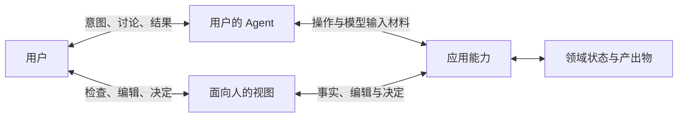

# 基础论述

[English](../../docs/foundations.md) | 简体中文

用户越来越多地通过 Agent 使用应用。用户可以用自然语言提出需要，而不先选择满足需要的软件。Agent 可以寻找合适的应用、理解其能力、组织操作并返回结果。用户面向 Agent，Agent 则代表用户寻找和使用应用。

直接使用产品时，用户把自己的目的与产品的概念、操作和当前状态联系起来。委托可以把一部分工作交给 Agent。应用通过 Agent 的判断与行动，继续服务于用户的目的。[Agent Native 宣言](../README.md)从这一关系变化出发。

## 设计渊源：从 shell 到 Agent

Agent Native 延续 Unix 的组合立场：能力小而专、只做一件事并做好，用通用方式连接，组合产生单个部件从未被设计过的用途。在 Unix 里，组合由 shell 完成，结果由终端前的人负责。Agent Native 把 shell 的座位交给用户的 Agent：它持有用户的目的，寻找应用，在运行时组合各应用的操作与结果。这样的组合要求连接携带含义而不拥有含义，要求应用说明自身、对自己的效果负责。

## 委托使用的条件

本文的原则来自一个问题：应用要服务一位通过 Agent 行动的用户，必须满足什么？

三个前提和一个观察给出答案。论证从一种关系开始：Agent 是直接的调用方；它的正当性来自用户的授权，而不是自身的主张。

**目的。** 在工作性使用中，应用是手段。价值来自用户的目的，而不是应用自身的边界。无法到达的手段不是手段。

**知识。** 行动需要关于手段与处境的知识。无法理解、或无法知道当前状态的操作，可以被调用，但不能被使用。契约知识与当前事实是不同的对象，彼此不能替代。

**责任。** 委托转移执行和有边界的决定权，不转移对目的的责任。系统可以执行决定，但不能对目的负责。责任需要一个能够承担它的主体。授权工作的人，仍然对目的和保留给自己的决定负责。

**工作。** 工作不必然被应用边界截断。应用边界是管理边界，用户的目的不是。工作在其他地方继续时，结果必须带着含义、来源、范围和授权访问一起过去。

由此得到四个条件：

| 条件 | 要求 | 范围 |
| --- | --- | --- |
| 可达 | Agent 能沿受支持的路径找到应用并到达操作。 | 每次委托使用 |
| 可理解 | 应用以有根据的方式提供操作的含义、效果和当前状态，并说明条件和限制。 | 每次委托使用 |
| 可延续 | 结果能进入下一步，而下一个应用不必重建其含义、来源、范围或授权访问。 | 工作在其他地方继续时 |
| 可问责 | 行动可归属于获授权的主体，保留的决定经过验证，效果可被检查，并在可能时纠正。 | 行动产生效果，或决定保留给人时 |

在委托使用范围内，前两个条件是无条件的；后两个是有条件的。并非每项工作都会继续到别处，也并非每项工作都保留决定。说明条件本身是主张的一部分，不是事后附加的限制。四条是必要条件，不是充分条件：应用可以满足四条，但仍然缓慢、不安全或出错。

后面的四条原则展开这些条件。“让产品被用户的 Agent 发现”展开可达；“让操作可理解，而不只是可调用”展开可理解；“在跨越边界时保住含义、来源与授权访问”展开可延续；“委托行动，保留有效判断”展开可问责。

应用可以可达、可理解而不可延续；但缺少前两个，就不可使用。

### 论证确立什么，不确立什么

论证确立三件事：

- 无法到达或无法理解的应用，不能服务委托工作，内部质量再高也不行。
- 结果在边界处丢失含义、来源、范围或授权访问，会把重建成本推给下一个应用和用户。
- 保留决定的责任，不能转移给 Agent 的断言。

论证没有确立：

- Agent 在设计冲突中应优先于人类用户；
- 应用应提供多少发现、互操作或批准；
- 产品把哪些决定保留给人；
- 每项任务都需要人留在回路中。

这些是产品与政策选择。它们需要产品与政策理由，而不是哲学必然性。

### 边界

论证针对委托给 Agent 的工作，不针对软件的一切使用。直接使用、游戏、艺术和探索，不必以同样方式满足这些条件。

可达不要求公开注册表；可理解不要求把所有细节放进一份文档；可延续不要求每个结果都可移植；可问责不要求每一步都批准。它要求保留的决定被识别、验证，并且可以纠正。

一个随进程结束的本地工具是可达、可理解、可问责的，但不可延续，因为没有工作继续。一个在缺少必要决定时拒绝执行的应用是可问责的，不是坏掉的。

### 未决问题

- 设计单位是应用还是工作？应用是设计对象，使用关系是评价对象。
- 人的判断是指设定目的、批准保留决定，还是承担最终责任？论证支持第一和第三；第二是产品选择。
- 信任是第五个条件，还是可理解与可问责的后果？本文暂不回答。

## 让产品被用户的 Agent 发现

能力已经存在，不意味着 Agent 会把它纳入考虑。产品可能已准备好响应调用，却没有给 Agent 发起调用的理由。让能力存在，与让它的用处被识别，是应用设计的不同部分。

用户的 Agent 寻找软件时，带着用户的任务与约束。应用应在可触达的渠道中，清楚说明能帮助完成的工作及影响适用性的条件。开发者希望产品被选择，用户的 Agent 则寻找合适的手段。设计通过交付吸引 Agent 前来的帮助，连接这两种利益。

产品被选中后，应提供贯通操作、当前事实、结果和异常处理的完整路径。可委托的工作不应要求 Agent 浏览页面、从布局推断含义或模拟点击。这些要求迫使它从为人设计的操作路径中重新推断应用的用法。

必须由人完成的访问步骤和保留给人的决定，仍可通过交接完成。交接应明确谁来行动、需要什么，以及调用方如何得知结果。仅仅要求用户替 Agent 执行，不能把缺失的操作变成合理的交接。

## 让操作可理解，而不只是可调用

操作可以交给 Agent，理解操作的工作却仍留给用户。应用可能提供调用，却不说明适用条件；可能持有状态，却需要用户读取后再转述；也可能宣布成功，却不提供可检查的结果。操作被委托出去，一部分工作又以解释、检查和修复的形式返回。

对于基于模型的 Agent，应用知识通过模型输入参与判断。描述、schema、Skill、当前事实和工具结果，只有被纳入模型输入才成为上下文。存储的材料需要有可用的路径进入其中。一个可调用但无法从现有输入中被理解和选择的操作，在技术上存在，在 Agent 的实际工作中却等于不存在。

应用提供准确描述自身能力、状态、条件、效果和限制的材料。Agent 按需选择并组织这些材料，形成模型输入，不必一次性全部加载。应用不控制整份输入，也不保证模型的判断，但仍负责让自身材料清楚、当前且可获取。应用同时提供用户的 Agent 时，也承担该 Agent 的相应责任。

应用已经掌握自身用法中的许多知识。清晰的指引让这些知识可以直接采用：从哪里开始、哪些条件重要、如何检查结果，以及怎样从已知失败中恢复。Agent 可以在此基础上组织工作，无须反复猜测隐藏规则。稳定的机械步骤可以由应用自身执行。重要选择仍应留给判断，并能根据用户目的调整。

方法也包含对“什么重要”的判断。一条规则可能选出最清晰的照片，却排除了相册本想纪念的某个人仅有的一张照片。它满足了自己的标准，却违背了本应服务的目的。选择手段的标准开始替人决定目的。因此，指导必须把自己的假设交出来接受判断。它可以提供工作方法，却不能授予权限或替用户确定目的。应用仍须执行其负责的规则与权限约束。

## 在跨越边界时保住含义、来源与授权访问

在跨应用任务中，Agent 可以围绕用户的目的组织各应用的能力。一个应用的结果可以成为后续工作的材料。

每个应用仍对自己的操作和效果负责。它在更大活动中的价值，取决于提供的能力和知识，以及获准的调用方能否使用其结果。完整工作流和小型操作，都可以服务于预期的下一步。

结果应带着含义、来源、范围和授权访问进入下一步，下一个应用不必重建这些信息。

## 委托行动，保留有效判断

委托改变了用户了解实际进展的方式。Agent 选择事实、解释结果，并代表用户作出部分决定。面向人的视图让结果与后果可供检查、编辑和判断。工作需要时，视图可以丰富甚至复杂。改写一段文字或选定一张照片，可能比再发一条指令更准确地表达目的。

用户可能每一步都被征询，却仍缺少判断所需的事实。视图可能确认编辑已保存，而 Agent 的下一次操作却悄无声息地拿到旧版本。只有当用户的判断能够改变后续工作时，控制才有实际力量。Agent 的操作和人的视图必须使用同一领域状态。应用让后续操作能够获取已提交的修改；Agent 按需将相关修改纳入模型输入。

结果可以改变引导它产生的目的。执行成功不能决定结果的价值；价值仍有待在使用中判断。已经产生的效果成为后续行动的条件。新指令可以指导下一步，却不能仅凭自身撤销已经发生的事。

委托不会自动解除用户的责任。Agent 可能已经正确准备好生产部署，但发布审批者尚未决定是否执行。对于保留给人的决定，应用必须向负责的用户取得。Agent 可以准备事实、执行决定，却不能代替用户给出答案。

承担责任不意味着批准每一步。用户可以对范围明确的授权负责，并选择委托的程度。人的批准也不会解除应用对自身规则和效果的责任。

## 交互模型

这些关系存在于同一活动中。图中不限定部署和存储架构。

用户的 Agent 可以来自该应用，也可以来自其他产品。语言理解可以由该 Agent 承担。

## 从论证到应用设计

Agent Native 将这些条件确立为产品设计者和运营者的责任。这包括清晰的指引与模型输入所需的材料、可委托工作的直接使用路径、能让工作继续的结果，以及有效的人类参与。这不要求特定协议，也不要求移除人的界面。

现有工具和 API 优先的产品可能已经提供了这些条件。[应用模型](application-model.md)将其展开为设计选择。
